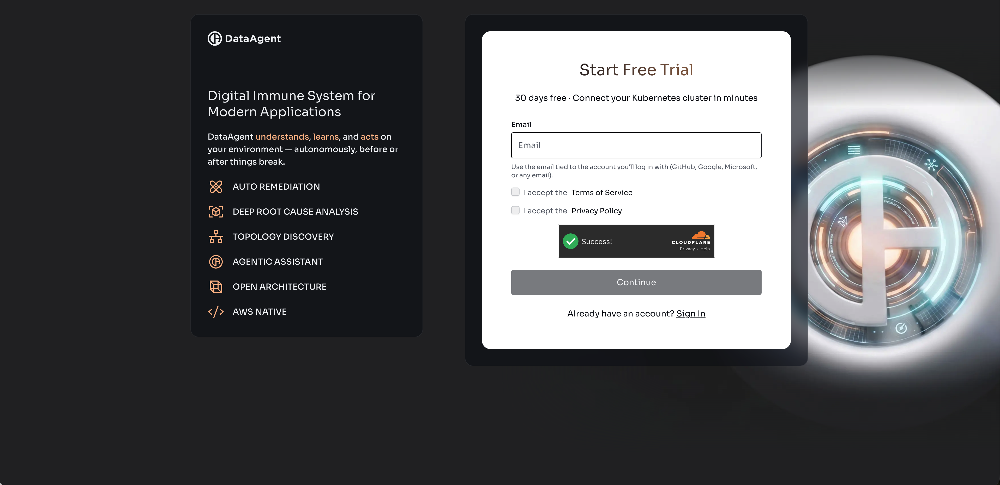
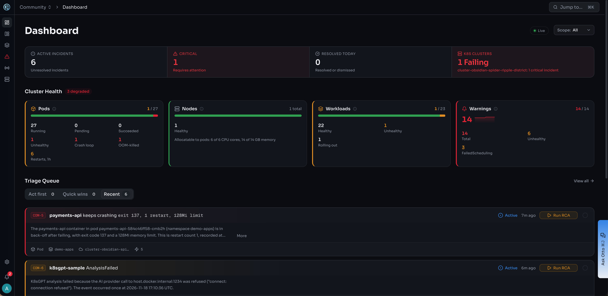

# Connect a cluster to DataAgent

So far, you have seen how K8sGPT, DataAgent's K8sGPT extension pack, and traditional metrics in Perses can be used to identify different types of incidents. Next, you can extend on these capabilities with a free trial of DataAgent.

DataAgent is a multi-tenant autonomous SRE platform that focuses on remediation first. It provides deep root cause analysis based on contextual information across your Kubernetes clusters.


DataAgent provides a free trial for you to see how it identifies, triages, and develops a root cause analysis of faults in a Kubernetes cluster.

This tutorial describes how to get started with DataAgent using the same local Kubernetes cluster from the [tutorial](../../../README.md).

## Sign up for a free DataAgent account

First, sign up for a free [DataAgent account](https://app.data-agent.co/sign-up):



Log in to the DataAgent dashboard once your account has been created.

## Connect your cluster

DataAgent runs as a lightweight agent inside of a Kubernetes cluster. The agent communicates diagnostic and contextual information to the DataAgent cloud. DataAgent then analyzes this information and uses it to identify incidents and perform root cause analysis.

The agent is deployed into Kubernetes with a Helm chart. First, launch the DataAgent dashboard and navigate to the **K8s Cluster** page:


Click **Connect Cluster**. The dashboard generates a unique connection token and provides the exact command needed to deploy the Helm chart. Copy this command and execute it against the cluster:

```bash
helm upgrade --install dataagent oci://ghcr.io/data-agent-co/dataagent-chart \
--version '0.1.267-e268505c' \
-n dataagent --create-namespace \
--set 'config.authToken=ivory-falcon-comet-sanctum' \
--set 'config.clusterName=cluster-ivory-falcon-comet-sanctum' \
--set 'config.hubUrl=...:443' \
--set 'imageCredentials.password=...'
```

The dashboard shows a success message once the cluster is connected to DataAgent. You can also monitor the status of the relevant pods in the DataAgent namespace:

```bash
kubectl get pods -n dataagent
```

DataAgent performs an initial baseline discovery against the Kubernetes cluster. Give this a few minutes to complete before running tests against the cluster.

## Inject a fault

Now that the cluster is connected to DataAgent, it's time to test out failure scenarios to see how DataAgent reacts.

First, trigger a failure scenario. This tutorial uses the out-of-memory test, but you can use any of the failure scenarios in the [tutorial](../../../README.md):

```bash
./scripts/trigger-oomkill.sh
```

DataAgent detects the failure and reports an incident within minutes:



Click on the incident to view the incident details. Take a few minutes to explore the incident details page. Several panels are helpful for a human operator to understand an incident's full context:

* The **Overview** panel provides a human-readable explanation of the incident.
* The **Signal Timeline** panel provides different visualizations of signals related to the incident.
* The **Linked Signals** panel shows a list of signals related to the incident. You can drill down into individual signals to see information related to them.
* The **History** panel provides a timeline of all events related to the incident.


## Perform a root cause analysis

DataAgent can determine a root cause analysis (RCA) by analyzing all of the context and signals that it receives from the Kubernetes cluster. DataAgent then proposes further troubleshooting and resolution steps based on the analysis.

Click the **Run RCA** button to initiate an RCA. This only takes a few minutes.

Once the RCA is completed, view details in the **Root Cause Analysis** panel. DataAgent doesn't just provide a simple analysis. It provides complete contextual information about next steps and how it determined the RCA. This includes:

* A **Remediation plan** with a series of next steps and risk scores associated with those steps. For example, it proposes a patch to increase memory for the OOM-killed service.
* An explanation of **what the analysis rests on** so that you can understand how DataAgent developed the RCA.
* A **Topology** that identifies relationships between services in the cluster and where the incident's root cause is located within the broader environment.
* A list of **evidence** and **tools used** when interrogating the environment for the root cause.


In a production environment, you could apply a patch to the deployment and increase its memory limits. However, the scenarios in this tutorial are designed to continue exhausting resources for the purpose of demonstration.

Stop the OOM exhaustion fault when you are done:

```bash
./scripts/trigger-oomkill.sh --stop
```

## Next steps

In this tutorial, you connected a Kubernetes cluster to DataAgent, injected a fault, and watched DataAgent detect the incident and produce a root cause analysis with a remediation plan. That's only a small slice of what DataAgent can do. Here are a few ways to keep going:

* **Meet Otto:** Otto is DataAgent's AI assistant. Ask it questions about your incidents and your cluster to dig deeper into what DataAgent has found. Start interacting with Otto by clicking the **Ask Otto** button on the DataAgent dashboard.
* **Explore the dashboard:** Try the other failure scenarios in this tutorial and look through the rest of the dashboard to see how DataAgent tracks signals, incidents, and history across your cluster.
* **Review Signals:** Navigate to the **Signals** page to see the dozens of Signals that DataAgent tracks to enable intelligent decision making. You can filter based on the Signal's source (K8sGPT, Prometheus, and others). This allows you to see how deep root cause analysis requires information from multiple sources.  
* **Deploy your own workloads:** Connect a cluster that runs your own applications to see how DataAgent handles the faults and incidents in your real environment.
* **Go deeper with our team:** Want a deep dive into DataAgent for your organization? [Contact us](https://data-agent.co/book-a-demo/) to set up a session with the team.
